# Hướng dẫn chi tiết – Hệ thống quản lý bãi đỗ xe

Tài liệu này bổ sung cho `README.md`: cài đặt từng bước, thiết kế cơ sở dữ liệu, quy trình nghiệp vụ,
hướng dẫn sử dụng theo vai trò và cách đưa mã nguồn lên GitHub.

---

## 1. Cài đặt từng bước

### 1.1. Phần mềm cần có

| Phần mềm | Phiên bản | Kiểm tra |
|---|---|---|
| Python | 3.11 trở lên | `python --version` |
| Node.js | 20 trở lên (khuyến nghị 22) | `node --version` |
| PostgreSQL | 14 trở lên (đã thử với 16) | `psql --version` |
| Git | bất kỳ | `git --version` |
| Docker Desktop | *tuỳ chọn* – thay cho cài PostgreSQL thủ công | `docker --version` |

### 1.2. Tạo database

Chọn một trong hai cách dưới đây. Nếu PostgreSQL cài sẵn đã chạy ở cổng 5432, hãy dùng dịch vụ đó;
không khởi động thêm Docker trên cùng cổng. Nếu database và tài khoản đã tồn tại, giữ nguyên dữ liệu,
user/mật khẩu và cấu hình `DATABASE_URL` phù hợp; không cần chạy lại các lệnh tạo bên dưới.

**Cách A – dùng Docker** (tại thư mục gốc dự án):

```bash
docker compose up -d
```

Lệnh trên tạo PostgreSQL ở cổng 5432, user `parking` / mật khẩu `parking`, hai database `parking_db`
(dùng chạy ứng dụng) và `parking_test` (dùng cho test).

**Cách B – PostgreSQL cài sẵn trên máy**: mở `psql` (hoặc pgAdmin → Query Tool) bằng tài khoản `postgres`:

```sql
CREATE USER parking WITH PASSWORD 'parking';
CREATE DATABASE parking_db OWNER parking;
CREATE DATABASE parking_test OWNER parking;
```

### 1.3. Chạy backend (Flask)

```bash
cd backend
python -m venv .venv
```

Kích hoạt môi trường ảo:

| Hệ điều hành | Lệnh |
|---|---|
| Windows (PowerShell) | `.venv\Scripts\Activate.ps1` |
| Windows (CMD) | `.venv\Scripts\activate.bat` |
| macOS / Linux | `source .venv/bin/activate` |

> Nếu PowerShell báo lỗi *running scripts is disabled*, chạy một lần:
> `Set-ExecutionPolicy -Scope CurrentUser RemoteSigned`

Cài thư viện và cấu hình:

```bash
pip install -r requirements.txt
cp .env.example .env          # Windows CMD: copy .env.example .env
```

Mở file `.env` và kiểm tra các biến:

| Biến | Ý nghĩa |
|---|---|
| `FLASK_APP` | Luôn là `wsgi.py` |
| `DATABASE_URL` | Chuỗi kết nối PostgreSQL của ứng dụng |
| `TEST_DATABASE_URL` | Chuỗi kết nối database test (bị xoá/tạo lại mỗi lần test) |
| `SECRET_KEY`, `JWT_SECRET_KEY` | Khoá bí mật – **bắt buộc đổi** khi triển khai thật (chuỗi ngẫu nhiên ≥ 32 ký tự) |
| `JWT_EXPIRES_HOURS` | Thời hạn phiên đăng nhập (giờ), mặc định 12 |
| `CORS_ORIGINS` | Domain frontend được phép gọi API, phân cách bằng dấu phẩy |
| `APP_TIMEZONE` | Múi giờ dùng cho thống kê theo ngày, mặc định `Asia/Ho_Chi_Minh` |

Tạo bảng, nạp dữ liệu mẫu và chạy server:

```bash
flask db upgrade              # chạy migration -> tạo 7 bảng
flask seed                    # tài khoản demo, thông tin bãi, 3 loại xe, bảng giá
flask run --host 127.0.0.1 --port 5000
```

Kiểm tra: mở <http://127.0.0.1:5000/api/health> → `{"status": "ok"}`. Endpoint này chỉ xác nhận
backend đang phản hồi, chưa xác nhận kết nối PostgreSQL vì không truy vấn database.

### 1.4. Chạy frontend (React + Vite)

Mở một cửa sổ terminal khác:

```bash
cd frontend
npm install
npm run dev
```

Truy cập <http://127.0.0.1:5173>. Khi chạy dev, Vite tự chuyển tiếp mọi request `/api/...` sang
`http://127.0.0.1:5000` (cấu hình trong `vite.config.js`). Giữ `VITE_API_URL` trống để dùng proxy;
không cần chỉnh CORS. Vite dùng cố định cổng 5173 và báo lỗi nếu cổng đã bị chiếm.
Địa chỉ `127.0.0.1` giúp tránh trường hợp `localhost` trỏ sang IPv6 `::1` và gọi nhầm dịch vụ khác.

### 1.5. Tài khoản demo

| Vai trò | Tên đăng nhập | Mật khẩu |
|---|---|---|
| Quản lý bãi xe | `admin` | `admin123` |
| Nhân viên bãi xe | `staff` | `staff123` |

Đặt mật khẩu khác ngay khi seed: `flask seed --admin-password <mk1> --staff-password <mk2>`.
Seed chỉ tạo tài khoản chưa tồn tại, không đặt lại mật khẩu tài khoản đã có.

### 1.6. Chạy test tự động

```bash
cd backend
python -m pytest -q           # 21 test, chạy trên database parking_test
```

### 1.7. Lỗi thường gặp

| Hiện tượng | Nguyên nhân / cách xử lý |
|---|---|
| `connection refused ... 5432` | PostgreSQL chưa chạy, hoặc sai host/cổng trong `DATABASE_URL` |
| `password authentication failed for user "parking"` | Sai thông tin kết nối PostgreSQL; đối chiếu `DATABASE_URL` với dịch vụ đang dùng, không tự đổi mật khẩu database |
| `Error: Could not locate a Flask application` | Chưa có `FLASK_APP=wsgi.py` trong `.env`, hoặc đang đứng sai thư mục (phải ở `backend/`) |
| Frontend báo *Không kết nối được máy chủ* | Kiểm tra backend tại `http://127.0.0.1:5000/api/health` và địa chỉ API; frontend không nhận được HTTP response |
| Đăng nhập trả HTML `404` hoặc *Đã xảy ra lỗi, vui lòng thử lại* qua `localhost` | Có thể đang gọi nhầm dịch vụ trên IPv6 `::1`; dùng `http://127.0.0.1:5173` và proxy `http://127.0.0.1:5000`. HTML `404` không chứng minh lỗi database |
| `401 INVALID_CREDENTIALS` / *Tên đăng nhập hoặc mật khẩu không đúng* | Backend đã truy vấn bảng tài khoản nhưng không tìm thấy user hoặc mật khẩu không khớp; kiểm tra tài khoản trong đúng database |
| `500 INTERNAL_ERROR` / *Lỗi hệ thống, vui lòng thử lại* | Xem traceback ở terminal backend để xác định nguyên nhân. Lỗi kết nối PostgreSQL hoặc thiếu bảng có thể gây `500`; không đồng nghĩa sai mật khẩu đăng nhập |
| Đăng nhập xong bị đẩy ra ngay | `JWT_SECRET_KEY` đã bị đổi trong lúc đang đăng nhập → đăng nhập lại |
| `relation "users" does not exist` | Chưa chạy `flask db upgrade` |

---

## 2. Thiết kế cơ sở dữ liệu

Thời gian lưu dạng `TIMESTAMP WITH TIME ZONE` (UTC). Số tiền lưu `BIGINT` theo đồng (VNĐ không có phần lẻ).
Các giá trị liệt kê (vai trò, trạng thái…) lưu dạng chuỗi kèm `CHECK constraint`.

```
users ─┬─< parking_sessions >── vehicle_types ──< price_rules
       │        │    │                               │
       │        │    └──────────── price_rule_id ────┘
       │        └──1:1── payments
       └─< incidents >── parking_sessions
parking_lot (1 dòng – thông tin bãi)
```

### users – tài khoản

| Cột | Kiểu | Ghi chú |
|---|---|---|
| id | serial PK | |
| username | varchar(50) UNIQUE | 3–50 ký tự: chữ, số, `.`, `_` |
| password_hash | varchar(255) | băm bằng Werkzeug (scrypt/pbkdf2) |
| full_name | varchar(100) | |
| role | varchar(20) | `MANAGER` / `STAFF` |
| is_active | boolean | `false` = bị khoá |
| created_at, updated_at | timestamptz | |

### parking_lot – thông tin bãi xe

`id, name, address, phone, opening_hours, description, updated_at`

### vehicle_types – loại phương tiện & sức chứa

| Cột | Kiểu | Ghi chú |
|---|---|---|
| code | varchar(30) UNIQUE | VD `MOTORBIKE`, `CAR` |
| name | varchar(100) | |
| capacity | int, `>= 0` | sức chứa tối đa |
| is_active | boolean | ngừng tiếp nhận loại xe |

### price_rules – bảng giá (có phiên bản)

| Cột | Kiểu | Ghi chú |
|---|---|---|
| vehicle_type_id | FK | |
| pricing_method | varchar(20) | `PER_TURN` / `PER_HOUR` / `PER_DAY` |
| unit_price | bigint `>= 0` | |
| effective_from | timestamptz | thời điểm bắt đầu áp dụng |
| note, created_by, created_at | | |

Giá đang áp dụng của một loại xe = bản ghi có `effective_from` lớn nhất nhưng `<= hiện tại`.

### parking_sessions – lượt gửi

| Cột | Kiểu | Ghi chú |
|---|---|---|
| code | varchar(20) UNIQUE | `LG` + `yyMMdd` + id 6 số, VD `LG261022000001` |
| plate_number | varchar(20) | biển số hiển thị, VD `29A-123.45` |
| plate_key | varchar(20) | biển số chuẩn hoá để so khớp, VD `29A12345` |
| vehicle_type_id | FK | |
| status | varchar(20) | `ACTIVE` / `PENDING_PAYMENT` / `COMPLETED` |
| check_in_at, check_out_at | timestamptz | |
| duration_minutes | int | |
| fee_amount | bigint | phí đã tính (giữ nguyên khi đổi giá) |
| price_rule_id | FK | bảng giá đã dùng để tính phí |
| checked_in_by, checked_out_by | FK users | |
| note | varchar(255) | |

Chỉ mục `uq_parking_sessions_active_plate`: `UNIQUE (plate_key) WHERE status IN ('ACTIVE','PENDING_PAYMENT')`
→ một biển số không thể có 2 lượt gửi đang hoạt động, kể cả khi 2 nhân viên bấm cùng lúc.

### payments – giao dịch thanh toán

`session_id` (UNIQUE, mỗi lượt gửi tối đa 1 giao dịch), `amount`, `method` (`CASH` / `TRANSFER`),
`paid_at`, `received_by`, `note`.

### incidents – yêu cầu xác minh ngoại lệ

`type` (`LOT_FULL`, `DUPLICATE_ACTIVE`, `SESSION_NOT_FOUND`, `INFO_MISMATCH`, `OTHER`),
`status` (`OPEN` / `RESOLVED`), `plate_number`, `session_id`, `description`, `created_by`,
`resolved_by`, `resolved_at`, `resolution_note`.

---

## 3. Quy trình nghiệp vụ

### 3.1. Vòng đời một lượt gửi

```
            check-in                  checkout (tính phí)               pay (xác nhận thu tiền)
  (không) ───────────► ACTIVE ─────────────────────────► PENDING_PAYMENT ─────────────────────► COMPLETED
                         ▲                                     │
                         └──────── cancel-checkout ────────────┘
             ACTIVE và PENDING_PAYMENT đều chiếm chỗ; chỉ COMPLETED mới giải phóng sức chứa
```

### 3.2. Xe vào (chức năng 1)

1. Nhân viên nhập biển số, chọn loại xe (thẻ loại xe hiển thị số chỗ trống).
2. Hệ thống kiểm tra lần lượt:
   - biển số đúng định dạng → nếu sai: `INVALID_PLATE`
   - loại xe tồn tại và đang tiếp nhận → nếu không: `INVALID_VEHICLE_TYPE`
   - xe chưa có lượt gửi đang hoạt động → nếu có: `DUPLICATE_ACTIVE_SESSION`
   - loại xe còn chỗ → nếu hết: `LOT_FULL`
3. Hợp lệ → tạo mã lượt gửi, ghi giờ vào, cập nhật sức chứa, hiển thị vé (có nút *In vé*).

### 3.3. Xe ra và thanh toán (chức năng 3, 4)

1. Nhập mã vé hoặc biển số → tìm lượt gửi đang hoạt động (không có: `SESSION_NOT_FOUND`).
2. Nhân viên nhập **biển số thực tế** và chọn **loại xe thực tế** để đối chiếu.
   - Không khớp → `VEHICLE_MISMATCH`, liệt kê trường sai lệch; nhân viên không thể cho xe ra.
   - Quản lý có thể chọn *Quản lý xác minh & cho xe ra* (bắt buộc nhập lý do).
3. Hệ thống ghi giờ ra, tính thời lượng, áp bảng giá hiện hành, hiển thị số tiền
   (chưa có bảng giá: `NO_PRICE_RULE`).
4. Nhân viên chọn hình thức thanh toán, (tuỳ chọn) nhập tiền khách đưa để tính tiền thối, bấm
   *Xác nhận đã thu tiền* → lưu giao dịch, lượt gửi `COMPLETED`, giải phóng chỗ.
   Phí tính quá 15 phút sẽ bị từ chối (`QUOTE_EXPIRED`) → bấm *Tính lại phí*.

### 3.4. Cách tính phí

| Cách tính | Công thức | Ví dụ (đơn giá 20.000đ) |
|---|---|---|
| Theo lượt | đơn giá | gửi 5 giờ → 20.000đ |
| Theo giờ | ⌈phút / 60⌉ × đơn giá, tối thiểu 1 giờ | 2 giờ 10 phút → 3 × 20.000 = 60.000đ |
| Theo ngày | ⌈phút / 1440⌉ × đơn giá, tối thiểu 1 ngày | 25 giờ → 2 × 20.000 = 40.000đ |

### 3.5. Cảnh báo ngoại lệ (chức năng 5)

Mọi cảnh báo `LOT_FULL`, `DUPLICATE_ACTIVE_SESSION`, `SESSION_NOT_FOUND`, `VEHICLE_MISMATCH` hiển thị khung
vàng kèm nút **Chuyển quản lý xác minh**: hệ thống tự điền loại ngoại lệ, biển số, mã lượt gửi và mô tả.
Quản lý xem ở trang *Yêu cầu xác minh*, ghi kết quả và đánh dấu đã xử lý. Ngoài ra trang *Tổng quan* cảnh
báo khi một loại xe đã đầy (thẻ đỏ) hoặc sắp đầy ≥ 90% (thẻ cam).

---

## 4. Hướng dẫn sử dụng theo vai trò

### Nhân viên bãi xe

| Trang | Việc làm được |
|---|---|
| Tổng quan | Xem số xe đang gửi, chỗ trống, lượt vào/ra hôm nay; tự làm mới mỗi 30 giây |
| Xe vào bãi | Tiếp nhận xe, in vé |
| Xe ra & thu phí | Tìm lượt gửi, đối chiếu, tính phí, xác nhận thu tiền |
| Tra cứu lượt gửi | Lọc theo biển số, mã, loại xe, trạng thái, khoảng ngày; xem chi tiết; nút *Cho xe ra* |
| Yêu cầu xác minh | Tạo và theo dõi các yêu cầu của mình |
| Bảng giá | Chỉ xem |
| Tài khoản của tôi (bấm tên ở góc phải) | Đổi mật khẩu |

### Quản lý bãi xe

Có toàn bộ quyền của nhân viên, cộng thêm:

| Trang | Việc làm được |
|---|---|
| Yêu cầu xác minh | Xem tất cả yêu cầu, ghi kết quả xử lý |
| Bảng giá | Tạo giá mới (áp dụng ngay hoặc hẹn giờ), huỷ giá chưa áp dụng, xem lịch sử |
| Bãi xe & sức chứa | Sửa thông tin bãi; thêm loại xe; đổi sức chứa (không nhỏ hơn số xe đang gửi); ngừng loại xe |
| Tài khoản | Tạo tài khoản, đổi vai trò, khoá/mở khoá, đặt lại mật khẩu |
| Thống kê lượt xe | Lượt vào/ra theo khoảng ngày và loại xe, theo từng ngày; sức chứa tại thời điểm xem |
| Thống kê doanh thu | Tổng tiền, số giao dịch, theo loại xe, theo ngày, theo hình thức thanh toán |

---

## 5. Ảnh giao diện

| | |
|---|---|
| Đăng nhập 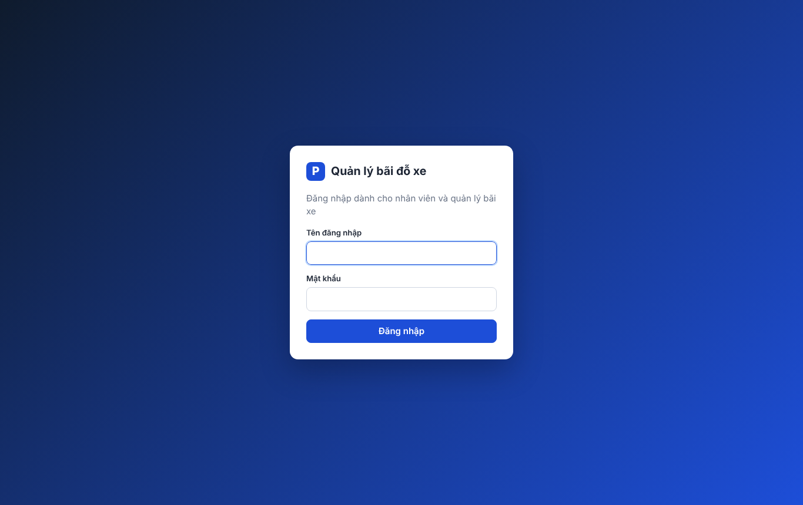 | Tổng quan (quản lý) 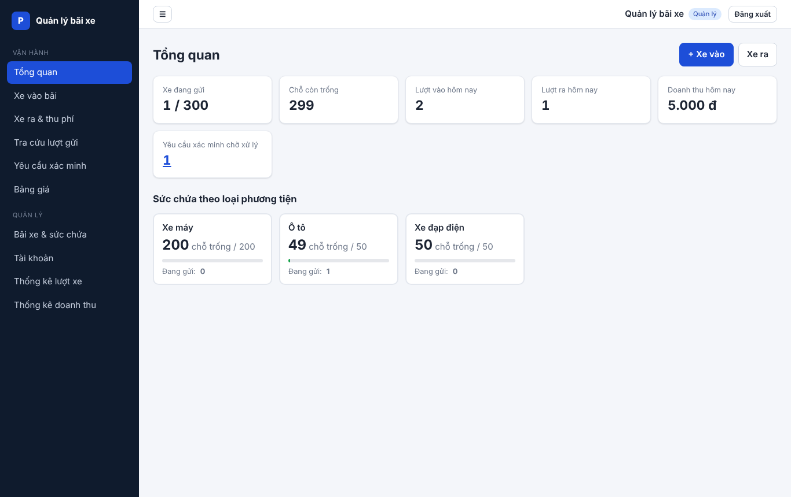 |
| Xe vào – cảnh báo trùng lượt gửi 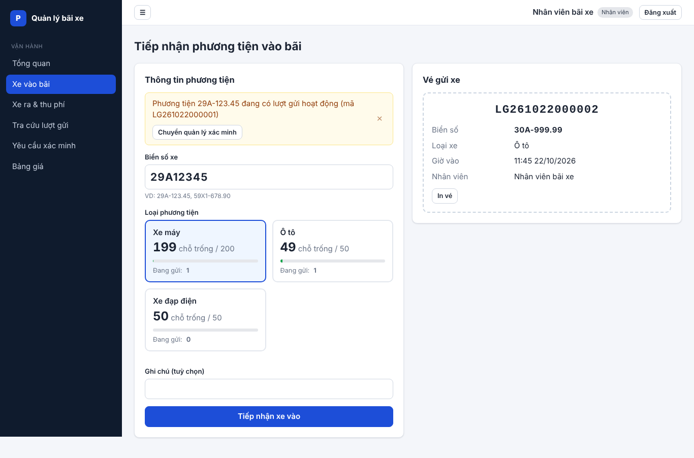 | Xe ra – thông tin không khớp 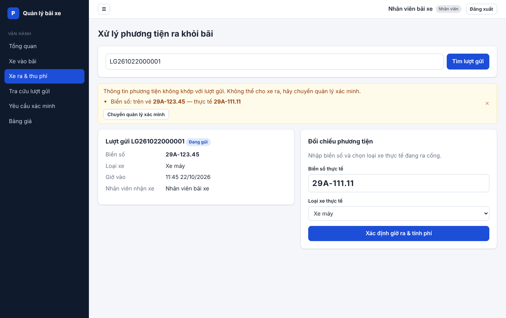 |
| Xe ra – thanh toán 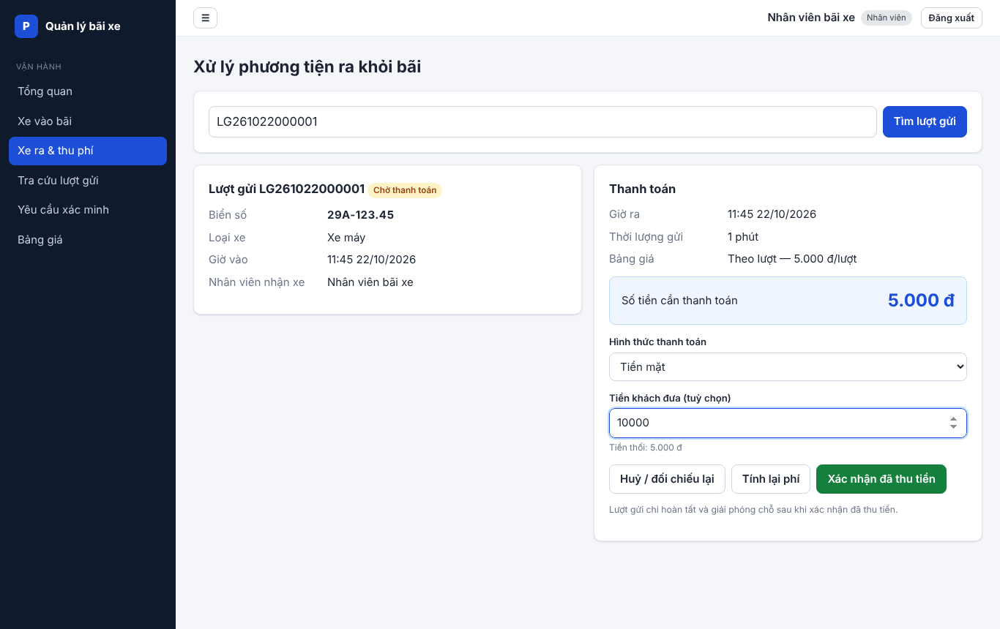 | Hoàn tất lượt gửi 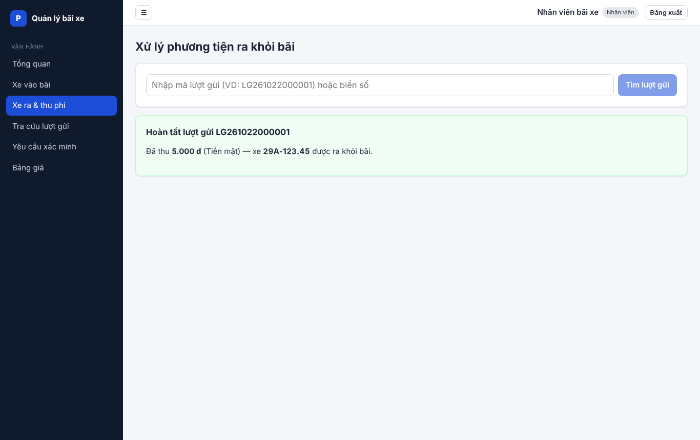 |
| Tra cứu lượt gửi 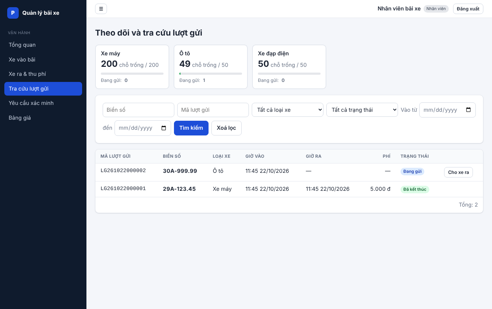 | Yêu cầu xác minh 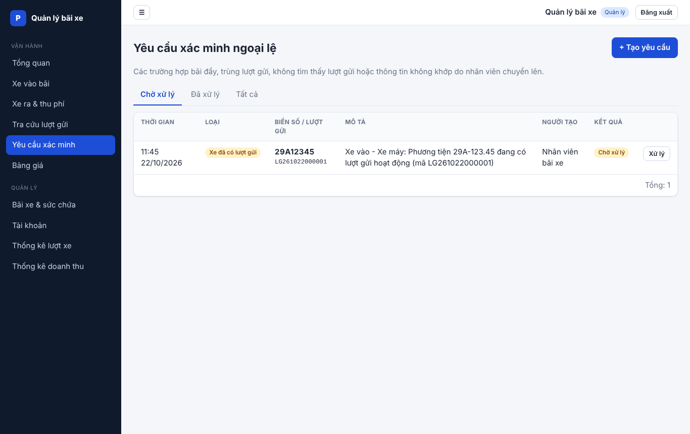 |
| Bãi xe & sức chứa 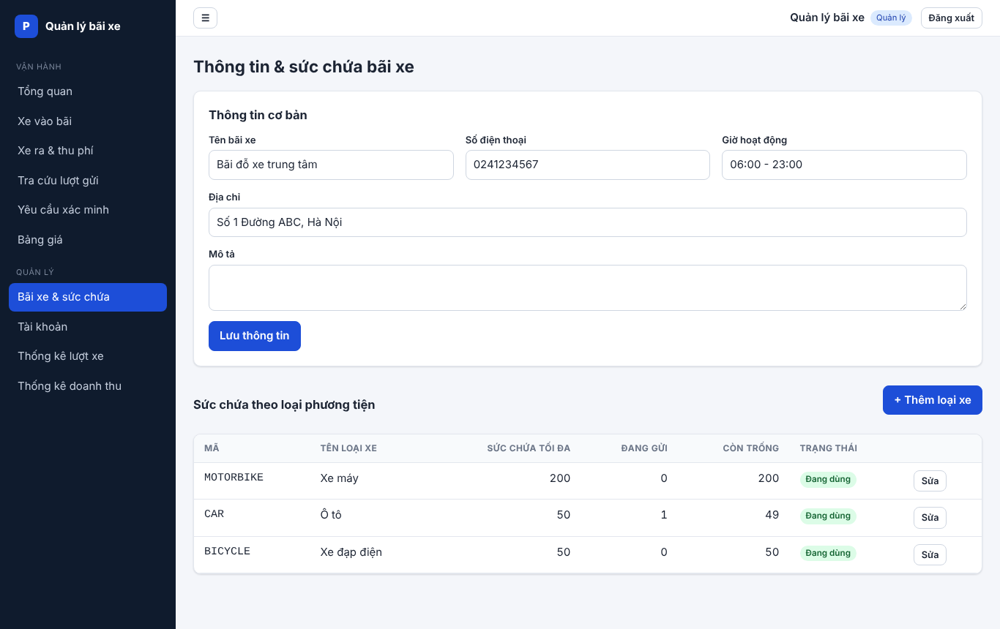 | Bảng giá 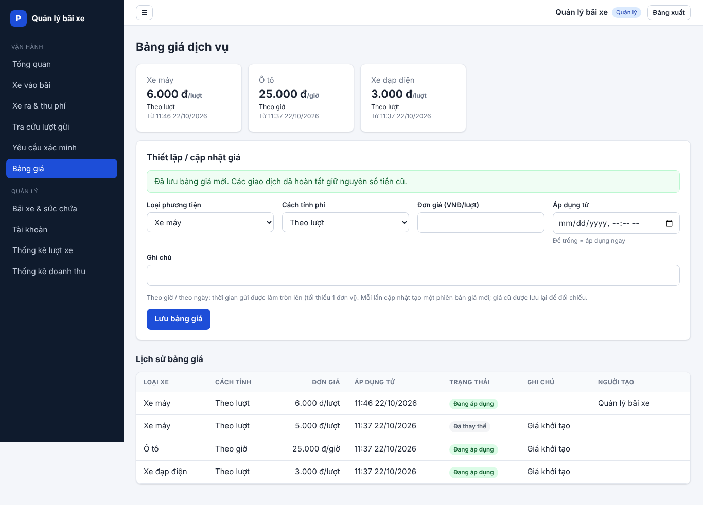 |
| Tài khoản 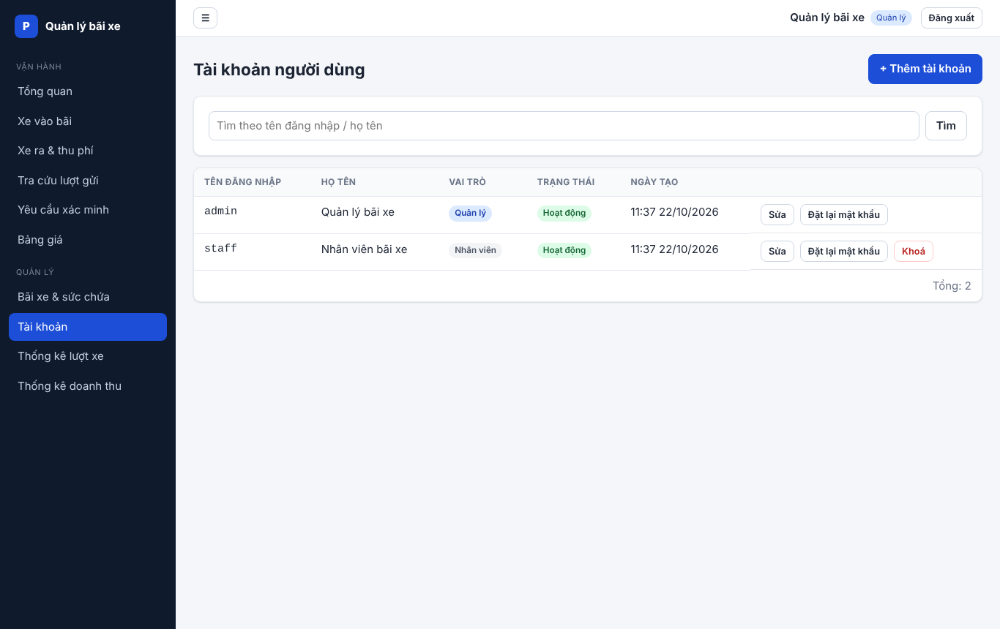 | Thống kê lượt xe 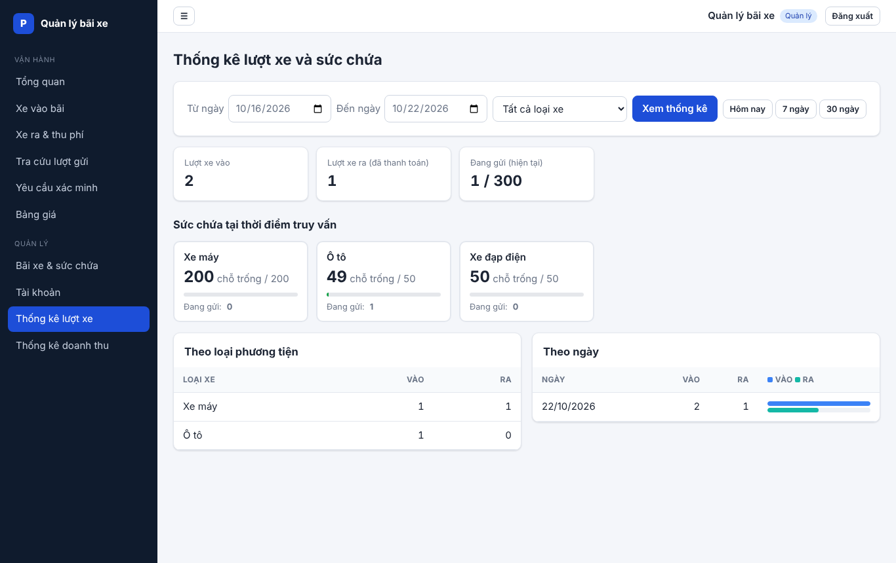 |
| Thống kê doanh thu 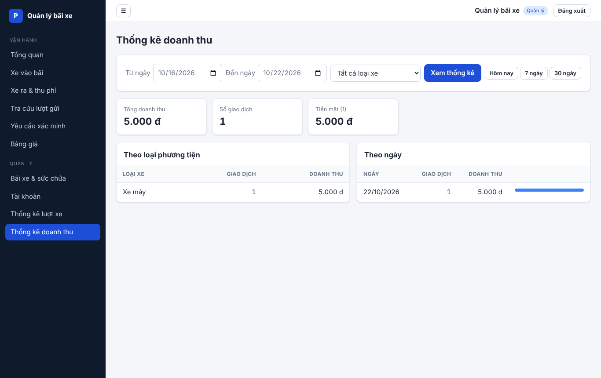 | Giao diện điện thoại 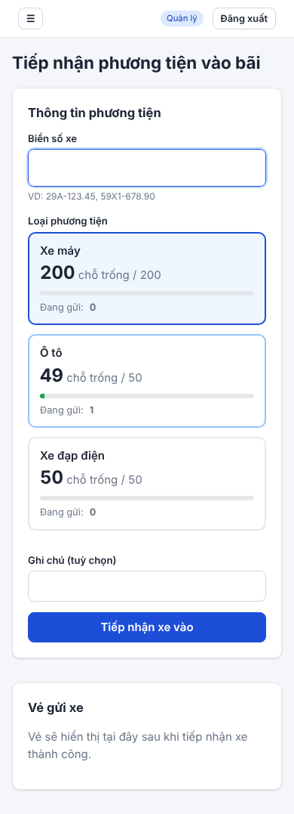 |

---

## 6. Đưa mã nguồn lên GitHub

File zip đã chứa sẵn lịch sử git (thư mục ẩn `.git`, nhánh `main`).

1. Trên GitHub bấm **New repository**, đặt tên (VD `parking-management`), **không** tick
   *Add a README / .gitignore / license* để repo trống.
2. Tại thư mục gốc dự án:

   ```bash
   git remote add origin https://github.com/<tai-khoan>/parking-management.git
   git push -u origin main
   ```

3. Mở tab **Actions** trên GitHub: workflow `CI` tự chạy migration, kiểm tra migration khớp models,
   chạy 21 test backend trên PostgreSQL và build frontend.

Quy trình làm việc nhóm gợi ý: mỗi tính năng một nhánh (`feature/...`) → Pull Request → CI xanh → merge
vào `main`. Không commit file `.env` (đã có trong `.gitignore`).

---

## 7. Triển khai production (gợi ý)

- Backend: `gunicorn -w 4 -b 0.0.0.0:5000 wsgi:app` (đã có trong `requirements.txt`) sau Nginx;
  chạy `flask db upgrade` mỗi lần cập nhật phiên bản.
- Frontend: `npm run build` → phục vụ thư mục `dist/` bằng Nginx; cấu hình fallback mọi đường dẫn về
  `index.html` (React Router). Nếu khác domain với API: build với `VITE_API_URL=https://api.ten-mien`
  và thêm domain frontend vào `CORS_ORIGINS`.
- Đổi `SECRET_KEY`, `JWT_SECRET_KEY`, mật khẩu database và mật khẩu tài khoản demo; bật HTTPS.
